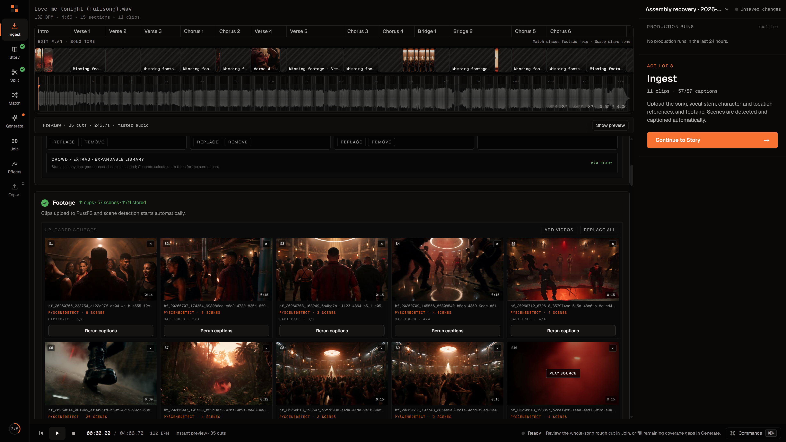

# Project Stack Structure

Web studio for music videos: provide a master song, creative direction and named references, build a beat-aligned story, generate missing shots, then review and export. Uploaded footage, stems and timed lyrics are optional.



**Live app:** https://project-stack-structure.vercel.app (GitHub sign-in) · **Status:** [docs/roadmap.md](docs/roadmap.md)

## Stack

- **UI:** Next.js 16, React 19, Bun (deployed on Vercel)
- **Jobs:** [Trigger.dev](https://trigger.dev) orchestration to GPU workers
- **Audio:** Essentia API (beats, sections, waveform)
- **Video:** media gateway (storage, scene detect), FFmpeg gateway (previews, export)
- **Captions:** LFM-2.5-VL (fast) and Qwen3-VL (smart scene captions)
- **Cloud generation:** Higgsfield (Nano Banana Pro stills, Seedance with audio reference)
- **Local generation:** SwarmUI and ComfyUI (MiniMax H3 image-to-video for gap fill)

## What it does

1. **Setup:** analyze the master track and add named character/location references; ingest footage when available.
2. **Story:** review and confirm the narrative and timed shot requirements.
3. **Draft:** reuse suitable footage, generate missing shots through local MiniMax H3 and managed SwarmUI, and review or revise the assembled cut.
4. **Finish:** approve the exact reviewed selection, prepare whole-song playback, export and download.

Split, Match, Join and effects remain detailed tools inside this journey. A zero-footage entry is supported; final export requires complete approved coverage. The [completion workflow](workflows/finish-music-video.md) records the remaining live and creative acceptance gates. Generated singing lip-sync is deferred.

## Quick start

Requirements: [Bun](https://bun.sh) ≥ 1.3, Node ≥ 24.5, ffmpeg/ffprobe on PATH.

```bash
bun install
cp .env.example .env.local  # names only — set values locally (git-ignored)
bun run dev                 # http://localhost:3000
```

Sign in with GitHub when prompted — every API route requires a session.

## Configuration

All settings come from environment variables. `.env.example` lists names only; set URLs and secrets in your local `.env.local` (git-ignored). Production values are materialized from **Bitwarden Secrets Manager** (project `hermes_keys`) on operator machines — never commit `.env` or `.env.local`.

Key groups: `AUTH_*` (GitHub OAuth + session signing), `TRIGGER_*` (background orchestration), `MEDIA_GATEWAY_*` (RustFS storage), `ESSENTIA_API_*`, `FFMPEG_GATEWAY_*`, `DEEPGRAM_API_KEY`, `SCENE_CAPTION_SMART_*`.

## Commands

```bash
bun run dev        # dev server
bun run build      # production build
bun run check      # lint + typecheck + tests
bun run test       # test suite
bun run e2e:media  # full pipeline e2e (needs running server + fixtures)
```

Tests use synthetic fixtures in `.local-fixtures/media/` (gitignored). The e2e run authenticates with `STACK_STRUCTURE_E2E_COOKIE` — see [tests/README.md](tests/README.md).

## How it fits together

| Layer | Role |
| --- | --- |
| Studio UI | Browser (Next.js on Vercel) |
| Song analysis | Essentia API (beats, sections, waveform) |
| Clip storage / scene detect | Media gateway (RustFS, PySceneDetect jobs) |
| Scene captions | Caption gateway (LFM fast path, Qwen3-VL smart path) |
| Preview / export | FFmpeg gateway (section previews, final export) |
| Background jobs | Self-hosted Trigger.dev control plane and GPU workers |

Every heavy step dispatches through Trigger.dev to GPU workers. Next.js routes authenticate, validate, and queue. Service base URLs are configured with `TRIGGER_API_URL`, `MEDIA_GATEWAY_URL`, `ESSENTIA_API_URL`, and related env vars (see `.env.example`).

## Deployment

- **Web app:** push to `main` → auto-deploys to Vercel. Env vars sync from BWS (`scripts/sync-vercel-production-env.ps1` from the ops machine).
- **Workers:** Trigger.dev tasks on the production GPU host — see `docs/operations/trigger-production.md`.
- **Security posture + hardening history:** [docs/security/api-hardening.md](docs/security/api-hardening.md).

## Documentation

- Architecture: [docs/architecture/product-infrastructure.md](docs/architecture/product-infrastructure.md) (start here)
- Background/model implementation: [Trigger execution contract](docs/protocols/trigger-execution-contract.md) — required request, progress, result, retry, and production verification rules
- Captions and prompts: [visible writing and output rules](docs/protocols/higgsfield-nano-banana-reference-continuity.md#visible-writing-and-output-rules) — describe what is visible; keep internal checks out of prose
- Media pipeline: [docs/architecture/media-pipeline.md](docs/architecture/media-pipeline.md)
- Roadmap: [docs/roadmap.md](docs/roadmap.md)
- Agent guidance: [AGENTS.md](AGENTS.md)

## Design rules

- **Musical alignment first** — beats and sections drive cuts.
- **Motion continuity** as the default visual mode.
- **Prepared previews** — explicit recompute states, no laggy pseudo-live playback.
- **Human approval** — Match and Join gate what enters the timeline.

Music-video story and matching behavior: [editing contract](docs/protocols/music-video-editing.md). Read this before changing semantic gates, cut ranking, or reuse behavior.
